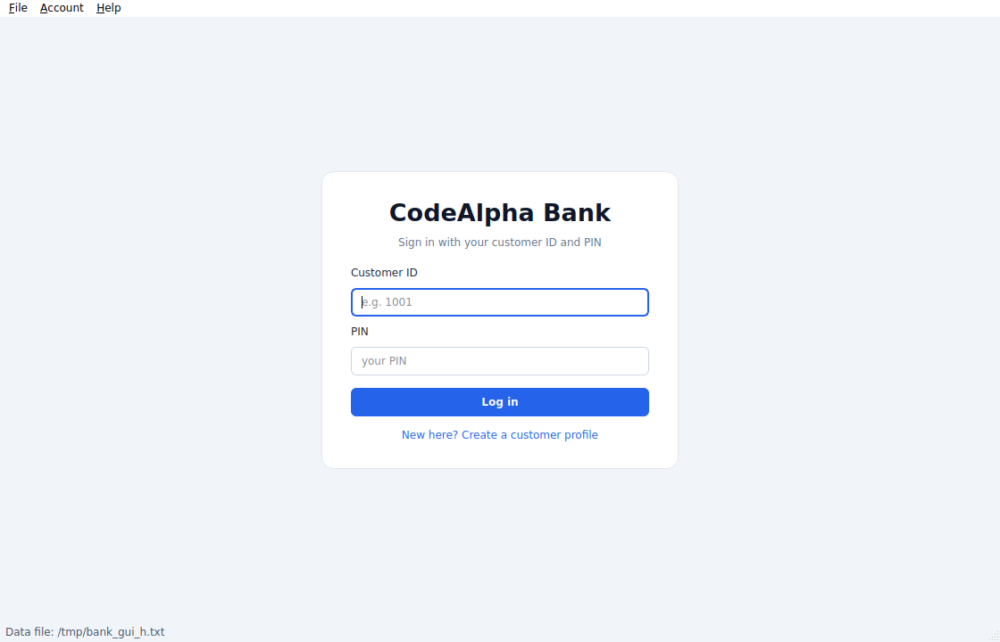
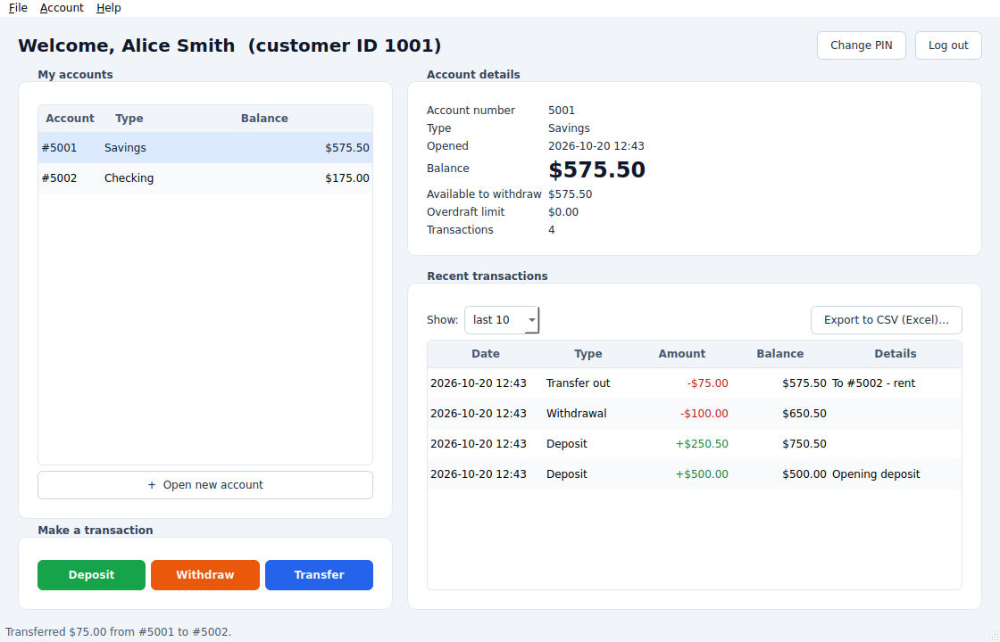
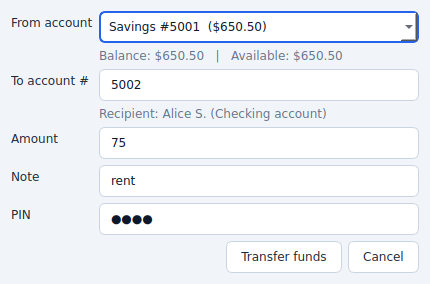

# Banking System (Qt 6 GUI) — CodeAlpha C++ Internship

A desktop banking application built with **C++17** and **Qt 6 Widgets**.
Customers sign in with a **customer ID and PIN**, manage Savings and Checking accounts,
deposit, withdraw, transfer money, review transaction history and **export statements to CSV for Microsoft Excel**.

| Sign in | Dashboard | Transfer (PIN-confirmed) |
|---|---|---|
|  |  |  |

## Features

**Banking**
- Customers with several accounts each: **Savings** (never below $0.00) and **Checking** (overdraft up to $200.00)
- Deposit, withdraw and transfer. A transfer either fully happens or does nothing, and creates a linked *Transfer out* / *Transfer in* record on each account
- Account details panel (balance, available amount, overdraft limit, opening date) and a transaction table (last 10 / 25 / 50 / 100 / all) with green credits and red debits
- Money is stored as whole **cents**, so there are no rounding errors

**PIN security**
- Every customer chooses a **4–8 digit PIN** at registration. Obvious PINs (`0000`, `1234`, `4321` …) are refused
- The PIN is **never stored**: only a random salt and a 10,000-round salted SHA-256 hash are saved, compared in constant time
- **Lockout:** 5 wrong PINs block the profile for 5 minutes. The counter is saved to disk, so restarting the program does not reset it
- Wrong customer ID and wrong PIN give the **same message**, so nobody can discover which IDs exist
- **Withdrawals and transfers ask for the PIN again**, and a PIN can be changed from the window (the current PIN is required)
- **Automatic log-out after 5 minutes** without mouse or keyboard activity
- Transfer recipients are shown with a **masked name** ("Alice S.") instead of the full name

**Storage and export**
- One local data file (`bank_data.txt`, plain text), saved atomically after every change (temp file + rename)
- Safe loading: header, field counts, owners, PIN-hash format, and every account's balance is re-checked against its transaction history. A damaged or edited file stops the program with a clear message and is **never overwritten**
- Older data files without PINs still open; the customer is asked to choose a PIN at first login
- **CSV export** (selected account or all accounts) with a UTF-8 BOM and Windows line endings so Excel opens it correctly. Amounts are plain numbers (`-75.00`) so Excel can sum them. Text cells starting with `= + - @` are neutralised, so a transfer note like `=HYPERLINK(...)` cannot run as an Excel formula

## Project layout

```
CMakeLists.txt
core/                 banking logic, no Qt code (unit-tested)
  Money.h  Transaction.h  Customer.h  Account.h/.cpp
  Bank.h/.cpp         rules, PIN authentication, load/save
  Crypto.h/.cpp       SHA-256, salt, constant-time compare
  Csv.h/.cpp          Excel-friendly export
  FileUtil.h/.cpp     atomic file writing
gui/                  Qt 6 Widgets interface
  main.cpp            starts the app, loads the data file
  MainWindow.*        dashboard, menus, operations, idle log-out
  LoginPage.*         sign-in screen
  Dialogs.*           register, PIN, open account, deposit/withdraw/transfer
  Style.h             style sheet
tests/test_core.cpp   unit tests for the core
```

## Build and run

You need **Qt 6.2 or newer** (Widgets), **CMake 3.16+** and a C++17 compiler.

### Qt Creator
1. Install Qt 6 with the [Qt Online Installer](https://www.qt.io/download-qt-installer) (a desktop kit + Qt Creator).
2. **File → Open File or Project…** → choose `CMakeLists.txt`.
3. Select your Qt 6 kit → **Configure Project** → **Run** (Ctrl+R).

### Visual Studio Code
1. Install the *C/C++* and *CMake Tools* extensions (suggested automatically by `.vscode/extensions.json`).
2. Set the environment variable `QT_ROOT_DIR` to your Qt kit folder (e.g. `C:\Qt\6.7.2\msvc2019_64`) or edit `.vscode/settings.json`.
3. Open the folder → **CMake: Configure** → pick a kit → **CMake: Build** → **CMake: Run Without Debugging**.

### Command line
```bash
# Ubuntu/Debian
sudo apt install qt6-base-dev cmake build-essential

cmake -S . -B build -DCMAKE_BUILD_TYPE=Release
cmake --build build
./build/BankingGUI                    # data file in your app-data folder
./build/BankingGUI ./bank_data.txt    # or choose the data file yourself
ctest --test-dir build --output-on-failure   # unit tests
```
macOS: `brew install qt cmake`, then add `-DCMAKE_PREFIX_PATH=$(brew --prefix qt)`.
Windows: add `-DCMAKE_PREFIX_PATH=C:/Qt/6.x.x/<kit>` and run `windeployqt BankingGUI.exe` before sharing the program.

## Using it

1. **Create a customer profile** on the sign-in screen (name, phone, PIN). You receive a **customer ID**: write it down.
2. **Log in** with the ID and PIN, then **Open new account** (optionally with an opening deposit).
3. Use **Deposit / Withdraw / Transfer**. Withdraw and Transfer ask for your PIN.
4. **Export to CSV (Excel)…** saves the selected account's statement, or use *File → Export all accounts*.

Shortcuts: `Ctrl+N` open account · `Ctrl+D` deposit · `Ctrl+W` withdraw · `Ctrl+T` transfer · `Ctrl+E` export · `Ctrl+L` log out

## Honest security notes
- PINs are short, so an attacker who steals the data **file** could still guess them offline. The lockout protects the **program**, not the file. A real bank would also encrypt the file and use a slow, purpose-built hash (Argon2/bcrypt).
- Customers created before PINs existed can set their first PIN without proof of identity (there is nothing to check yet). This only applies to old data files.
- The currency symbol is `$`; change `formatMoney` in `core/Money.h` to use another one.

## CodeAlpha submission checklist
- [ ] GitHub repo named `CodeAlpha_BankingSystem`
- [ ] LinkedIn video: register, log in, open accounts, deposit, withdraw (try a wrong PIN), transfer, change PIN, export the CSV and open it in Excel, show the lockout after 5 wrong PINs
- [ ] Post the repo link on LinkedIn, tag @CodeAlpha, and submit the form
